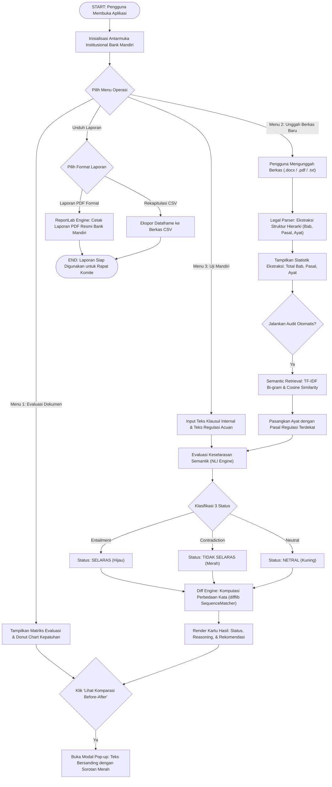

# SELARASKAN MDAB : Sistem Uji Keselarasan Regulasi Perbankan

Sistem audit kepatuhan regulasi berbasis kecerdasan buatan (Regulatory Compliance and Alignment AI) yang dirancang untuk menguji keselarasan norma antara Petunjuk Operasional (SOP/PO) internal Bank Mandiri dengan regulasi pemerintah dan otoritas terkait (POJK, Bank Indonesia, UU Perlindungan Data Pribadi).

Konsep dan arsitektur sistem ini terinspirasi dari produk **Big Legal by BigBox (Telkom Indonesia)**, dibangun dengan standar desain institusional perbankan yang bersih, formal, dan profesional.

---

## 1. Latar Belakang Masalah

Bank Mandiri sebagai bank BUMN sistemik (KBMI 4) beroperasi di bawah pengawasan regulasi yang ketat. Setiap kali regulator menerbitkan Surat Edaran atau Peraturan Otoritas Jasa Keuangan (POJK) baru, tim Kepatuhan dan Hukum bank wajib menelaah ribuan lembar dokumen SOP internal.

Tantangan utama operasional saat ini:
1. **Audit Manual yang Memakan Waktu**: Memeriksa klausul internal secara manual membutuhkan waktu mingguan hingga bulanan.
2. **Risiko Sanksi Regulasi**: Keterlambatan atau kelalaian dalam menyesuaikan SOP berisiko menimbulkan sanksi administratif dan denda kepatuhan dari regulator.
3. **Ketiadaan Komparasi Visual Presisi**: Sulit mengidentifikasi deviasi kata per kata secara cepat antara kewajiban hukum eksternal dan petunjuk operasional internal.

SELARASKAN MDAB hadir untuk memvalidasi kelayakan otomasi proses uji keselarasan regulasi secara terukur, transparan, dan dapat dijelaskan (explainable AI).

---

## 2. Diagram Alir Sistem (Start to End)

Diagram alir berikut menggambarkan siklus penuh pemrosesan data pada SELARASKAN MDAB:



---

## 3. Daftar Tools dan Teknologi yang Digunakan

| Komponen | Pustaka / Teknologi | Versi | Peran dalam Sistem |
| :--- | :--- | :--- | :--- |
| **Bahasa Pemrograman** | Python | 3.10 - 3.12 | Bahasa utama implementasi pipeline dan logika sistem |
| **Kerangka Kerja Antarmuka** | Streamlit | 1.37+ | Antarmuka interaktif, tata letak dua kolom, dan modal dialog (`@st.dialog`) |
| **Visualisasi Data** | Plotly Graph Objects | 6.0+ | Diagram donat interaktif distribusi tingkat kepatuhan regulasi |
| **Legal Document Parser** | Python-docx & PyPDF | docx 1.2+, pypdf 6.2+ | Ekstraksi teks dan penguraian struktur Bab/Pasal/Ayat dari Word dan PDF |
| **Semantic Retrieval (RAG)** | Scikit-Learn | 1.5+ | Pencocokan otomatis pasal acuan berbasis TF-IDF bi-gram dan Cosine Similarity |
| **Diff Highlighter Engine** | Python `difflib` | Modul Standar | Komparasi redaksional kata per kata (`SequenceMatcher`) dan penandaan warna |
| **Generator Laporan Resmi** | ReportLab | 5.1+ | Pembuatan berkas laporan audit resmi PDF berstandar perbankan nasional |
| **Manipulasi Data** | Pandas | 2.0+ | Manajemen tabel data, pemfilteran klausul, dan ekspor CSV |

---

## 4. Panduan Menjalankan Prototipe di Komputer Lokal

### Prasyarat
Pastikan komputer Anda telah terpasang **Python** (versi 3.10, 3.11, atau 3.12) dan **Git**.

### Langkah 1: Kloning Repositori
```bash
git clone https://github.com/desmanveliushalawa/selaraskan-mdab.git
cd selaraskan-mdab
```

### Langkah 2: Buat dan Aktifkan Lingkungan Virtual (Rekomendasi)
```bash
# Windows (PowerShell)
python -m venv .venv
.\.venv\Scripts\Activate.ps1

# Linux / macOS (Bash)
python3 -m venv .venv
source .venv/bin/activate
```

### Langkah 3: Pasang Dependensi
```bash
pip install -r requirements.txt
```

### Langkah 4: Jalankan Unit Test (Verifikasi Sistem)
```bash
python -m unittest discover -s tests -v
```
Seluruh 22 unit test wajib berstatus `OK` (100% Pass).

### Langkah 5: Jalankan Aplikasi Streamlit
```bash
streamlit run app.py
```
Aplikasi otomatis terbuka di peramban web pada alamat `http://localhost:8501`.

---

## 5. Panduan Penggunaan Fitur Sistem

### Tab 1: Matriks Keselarasan Dokumen
1. Menampilkan ringkasan metrik kepatuhan dokumen Petunjuk Operasional TI Bank Mandiri terhadap regulasi acuan.
2. Di sebelah kiri terdapat penelusuran hierarki dokumen (Bab per Bab).
3. Di sebelah kanan terdapat kartu hasil evaluasi dengan tiga badge status:
   - **SELARAS**: SOP memenuhi atau melampaui standar kementerian/regulator.
   - **TIDAK SELARAS**: Ditemukan pertentangan atau deviasi batas kepatuhan.
   - **NETRAL**: Ketentuan teknis prosedural internal bank yang tidak bertentangan.
4. Klik tombol **"Lihat Komparasi Before-After"** untuk membuka jendela modal perbandingan kalimat bersanding dengan kata-kata deviasi disorot warna.
5. Unduh laporan formal melalui tombol **"Unduh Laporan Formal (PDF)"** atau CSV di sidebar kiri.

### Tab 2: Unggah & Cek Keselarasan
1. Pilih bucket dokumen acuan kepatuhan yang ingin dijadikan tolok ukur (Regulasi Eksternal, KPKD, atau Juknis KUR).
2. Tentukan dokumen internal target (tersedia tombol cepat: SOP KUR, RIPLAY, KPKD, atau unggah berkas `.pdf`/`.docx`/`.txt` sendiri).
3. Sistem mengekstrak struktur Bab dan Pasal secara terstruktur.
4. Klik tombol **"SUBMIT CEK KESELARASAN"** untuk menjalankan audit inferensi semantik terhadap bucket acuan terpilih.

### Tab 3: Manajemen Bucket Dokumen Acuan
1. Mengelola repositori regulasi rujukan secara dinamis (tidak terkunci statis di database).
2. **Tambah Berkas ke Bucket**: Unggah berkas peraturan resmi untuk diekstrak dan diindeks pasalnya ke bucket yang sudah ada.
3. **Buat Bucket Baru**: Membuat kategori bucket acuan baru untuk memisahkan domain kepatuhan (misal: Unit APU PPT, Audit TI, Manajemen Risiko).

### Tab 4: Uji Klausul Mandiri
1. Masukkan teks draf klausul internal bank pada kolom kiri.
2. Masukkan teks pasal regulasi rujukan pada kolom kanan.
3. Klik tombol **"Jalankan Uji Keselarasan"** untuk melihat inferensi status kepatuhan, pertimbangan hukum ringkas, dan visualisasi diff kata per kata.

### Tab 5: Arsitektur & Konsep Sistem
1. Memuat penjelasan metodologi Natural Language Inference (NLI), audit bertingkat (*multi-tier compliance*), dan mitigasi risiko kerahasiaan data perbankan melalui skema implementasi privat on-premise.

---

## 6. Struktur Berkas Repositori

```
selaraskan-mdab/
├── app.py                      # Antarmuka utama aplikasi Streamlit (5 Tab)
├── data/
│   ├── bank_mandiri_demo.json  # Korpus studi kasus Petunjuk Operasional Bank Mandiri
│   └── buckets/                # Penyimpanan lokal metadata bucket regulasi acuan
├── engine/
│   ├── __init__.py             # Inisialisasi package engine
│   ├── alignment_engine.py     # Logika inferensi NLI dan perhitungan metrik kepatuhan
│   ├── bucket_manager.py       # Manajemen repositori regulasi dinamis multi-tier
│   ├── diff_highlighter.py     # Generator perbandingan kata bersanding (word-level diff)
│   ├── legal_parser.py         # Ekstraktor hierarki Bab/Pasal/Artikel dari DOCX dan PDF
│   ├── report_generator.py     # Generator dokumen laporan audit formal PDF (ReportLab)
│   └── semantic_retriever.py   # Mesin pencari semantik pasal acuan berbasis TF-IDF & Cosine
├── tests/
│   ├── test_bucket_manager.py  # Pengujian unit manajemen bucket & audit end-to-end
│   ├── test_engine.py          # Pengujian unit diff highlighter & alignment engine
│   ├── test_parser.py          # Pengujian unit ekstraktor dokumen hukum
│   ├── test_report_generator.py# Pengujian unit generator laporan PDF
│   └── test_retriever.py       # Pengujian unit mesin pencari semantik
├── requirements.txt            # Daftar pustaka dependensi Python
└── README.md                   # Dokumentasi resmi proyek
```

---

## 7. Keamanan Data dan Implementasi On-Premise

Untuk kebutuhan implementasi produksi di lingkungan Bank Mandiri:
- Arsitektur ini dirancang untuk dapat di-deploy secara **On-Premise** menggunakan infrastruktur server privat Bank Mandiri (menggunakan vLLM atau Ollama dengan model open-source seperti Llama-3-70B atau IndoLLM).
- Tidak ada data rahasia perbankan atau klausul internal yang dikirimkan ke penyedia komputasi awan pihak ketiga tanpa enkripsi dan persetujuan otoritas terkait.
