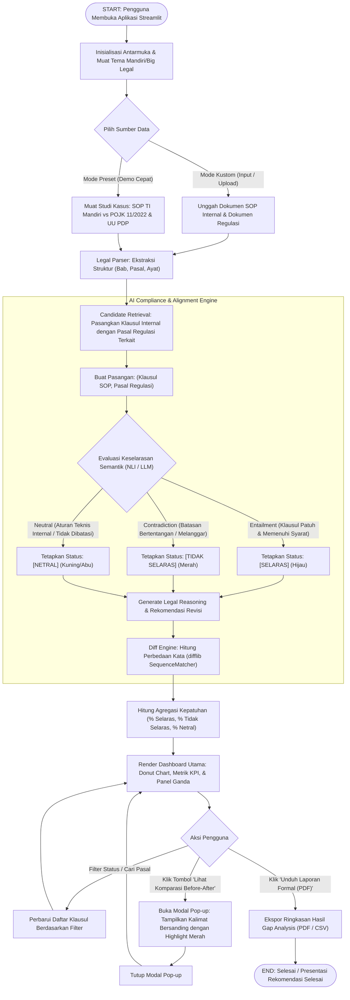

# Analisis Mendalam, Diagram Alir & Panduan Penggunaan Prototipe Uji Keselarasan Regulasi (SELARASKAN MDAB)

> **Target Proyek**: Prototipe AI Uji Keselarasan Regulasi Operasional Bank Mandiri vs Peraturan Pemerintah (SELARASKAN MDAB)  
> **Konsep Acuan**: Big Legal by BigBox (Telkom Indonesia)  
> **Framework**: Python & Streamlit  
> **Klasifikasi Output**: Selaras (Positif), Tidak Selaras (Negatif), Netral  

---

## 1. Executive Summary & Problem Understanding

Bank Mandiri sebagai bank BUMN sistemik (KBMI 4) beroperasi di bawah pengawasan ketat regulator: **OJK, Bank Indonesia, Kementerian Keuangan, Kementerian BUMN, dan Regulasi Nasional (UU PDP, dsb.)**.

Setiap kali regulator menerbitkan ketentuan baru (misal: POJK terkait Ketahanan Siber, Kebijakan Perlindungan Data Nasabah, atau Operasional Kredit), tim **Compliance & Legal Bank Mandiri** wajib mengaudit ribuan lembar dokumen internal seperti:
- **Pedoman Operasional (PO)**
- **Standar Prosedur Operasional (SOP)**
- **Surat Edaran Direksi (SE / SE Dir)**
- **Petunjuk Pelaksanaan (Juklak) & Petunjuk Teknis (Juknis)**

### Masalah Utama Saat Ini:
1. **Audit Manual & Rentan Human Error**: Mencocokkan pasal internal vs eksternal memakan waktu mingguan hingga bulanan.
2. **Keterlambatan Penyesuaian**: Risiko sanksi kepatuhan (*regulatory non-compliance penalties*).
3. **Ketiadaan Visualisasi Dampak**: Sulit melihat secara cepat pasal mana saja yang bertentangan (*gap analysis*) dan bagaimana draft perubahan yang disarankan.

---

## 2. Bedah Referensi Big Legal (Berdasarkan Bukti Gambar)

Berdasarkan 4 tangkapan layar yang diunggah dari produk *Big Legal by BigBox*:

### Unsur Inti yang Diadopsi ke Prototipe:
1. **Hierarchical Document Navigation (Panel Kiri)**: Menampilkan struktur hirarki peraturan internal (Judul -> Bab -> Pasal -> Ayat/Angka).
2. **Matching Regulation Cards (Panel Kanan)**: Menampilkan pasal pemerintah/kementerian terkait yang dipasangkan.
3. **Tri-State Classification Badges**:
   - `Selaras` (Positif / Compliant: Hijau)
   - `Tidak Selaras` (Negatif / Conflict: Merah)
   - `Netral` (Tidak terkait langsung / Diatur terpisah: Kuning/Abu-abu)
4. **Interactive Side-by-Side Before-After (Modal Pop-up Diff)**: Saat klausul diklik, muncul dialog perbandingan kata-per-kata yang menyorot perbedaan redaksi kalimat dengan warna merah.
5. **Executive Summary Widget**: Metrik ringkas berupa pie/donut chart agregasi tingkat keselarasan keseluruhan dokumen.

---

## 3. Diagram Alir Sistem Lengkap (Start to End)

Diagram alir berikut menggambarkan siklus penuh mulai dari pengguna membuka sistem, pemrosesan teks, inferensi klasifikasi keselarasan, visualisasi perbandingan (diff), hingga ekspor laporan hasil audit.



---

## 4. Analisis Teknis AI & Audit Ulang (Re-Audit)

### A. Mengapa Bukan Text Classification Biasa?
Klasifikasi teks biasa hanya membaca satu teks ($f(\text{teks}) \rightarrow \text{label}$).  
Sistem keselarasan ini merupakan **Pairwise Semantic Matching / Natural Language Inference (NLI)**:
$$f(\text{Klausa Internal}, \text{Klausa Eksternal}) \rightarrow \{\text{Selaras}, \text{Tidak Selaras}, \text{Netral}\}$$

### B. Matriks Audit Ulang (Self-Audit)
| Komponen Audit | Analisis Awal | Hasil Audit & Verifikasi |
| :--- | :--- | :--- |
| **Definisi "Netral"** | Dianggap sebagai data yang tidak cocok. | **Koreksi**: Dalam perbankan, "Netral" adalah klausul operasional internal (misal: shift jam kerja, form berkas) yang tidak dibatasi atau tidak bertentangan dengan regulasi eksternal. |
| **Kebutuhan Reasoning** | Cukup menampilkan badge status. | **Koreksi**: Orang legal Bank Mandiri tidak akan menerima label tanpa penjelasan hukum (*reasoning*) dan rekomendasi perbaikan pasal. |
| **Keamanan Demo** | Mengandalkan live call ke Cloud LLM. | **Koreksi**: Wajib memiliki skenario data lokal *pre-computed* agar demo di hadapan pimpinan tidak pernah gagal karena kuota atau jaringan. |
| **Visual Diff** | Memerlukan model machine learning baru. | **Koreksi**: Cukup menggunakan algoritma deterministik `difflib.SequenceMatcher` berbasis token kata yang cepat dan akurat. |

---

## 5. Panduan Cara Penggunaan Prototipe (Step-by-Step User Guide)

### Langkah 1: Menjalankan Aplikasi
Buka terminal di direktori proyek `d:\Project Desman\selaras`, lalu jalankan:
```bash
streamlit run app.py
```
Aplikasi otomatis terbuka di peramban web pada alamat `http://localhost:8501`.

---

### Langkah 2: Membuka Dashboard Utama (Executive Overview)
Saat aplikasi terbuka, pengguna langsung disajikan:
1. **Header Branding**: Identitas sistem *“SELARASKAN MDAB: Uji Keselarasan Regulasi Operasional”* dengan palet biru khas Mandiri dan aksen emas.
2. **Kartu KPI Ringkasan**:
   - Total Klausul yang Dievaluasi.
   - Persentase Selaras (Hijau).
   - Persentase Tidak Selaras (Merah: indikator risiko).
   - Persentase Netral (Kuning).
3. **Donut Chart Interaktif (Plotly)**: Visualisasi proporsi keselarasan dokumen persis seperti pada Gambar ke-1 Big Legal.

---

### Langkah 3: Navigasi Dokumen & Filter Klausul (Panel Kiri & Kanan)
1. **Panel Kiri (Struktur Dokumen Internal)**:
   - Menampilkan daftar Bab dan Pasal SOP yang dianalisis (misal: *BAB II Pasal 4 Angka 2: Enkripsi Data*).
   - Pengguna dapat memilih pasal tertentu untuk melihat fokus perbandingannya.
2. **Filter Cepat (Sidebar / Atas)**:
   - Pengguna dapat memfilter tampilan: *Tampilkan Semua*, *Hanya Tidak Selaras (Prioritas Risiko)*, *Hanya Selaras*, atau *Hanya Netral*.

---

### Langkah 4: Memeriksa Hasil Analisis & Rekomendasi
Pada setiap kartu pasal di Panel Kanan:
- Tertera nama regulasi eksternal rujukan (misal: *POJK No. 11/POJK.03/2022 Pasal 27*).
- Tertera badge status: `[Selaras]`, `[Tidak Selaras]`, atau `[Netral]`.
- Tertera **Catatan Analisis AI (Reasoning)**: Penjelasan mengapa klausul tersebut dinyatakan selaras atau tidak.
- Tertera **Rekomendasi Revisi**: Saran aksi konkret yang perlu dilakukan oleh tim legal.

---

### Langkah 5: Interaksi Fitur "Before-After Diff" (Modal Pop-up)
1. Pada kartu klausul (khususnya yang berstatus `[Tidak Selaras]`), klik tombol **"Lihat Komparasi Before-After"**.
2. Sebuah jendela dialog pop-up (`st.dialog`) akan muncul menampilkan:
   - **Kolom Kiri**: Redaksi Kalimat Petunjuk Operasional (Internal Bank).
   - **Kolom Kanan**: Redaksi Kalimat Regulasi Regulator (POJK / BI / UU).
   - **Highlight Kata Berwarna Merah/Hijau**: Menyorot secara presisi kata-kata yang berbeda atau bertentangan (misal: *"7 hari kerja"* vs *"3 x 24 jam"*), persis seperti tangkapan layar Gambar ke-3 Big Legal.

---

### Langkah 6: Menguji Klausul Baru (Tab "Uji Mandiri / Custom")
1. Pindah ke tab **"Uji Klausul Mandiri"**.
2. Masukkan teks klausul internal Anda dan teks pasal regulasi pemerintah.
3. Klik tombol **"Jalankan Uji Keselarasan"**.
4. Sistem akan langsung memproses perbandingan semantik, menentukan status, menghasilkan *reasoning*, dan merender perbandingan *diff*.

---

### Langkah 7: Ekspor Hasil Laporan
1. Klik tombol **"Unduh Laporan Formal (PDF)"** atau **"Unduh Rekapitulasi Data (CSV)"** di sidebar.
2. Berkas hasil analisis dapat langsung diunduh untuk dibagikan kepada tim kepatuhan atau dimasukkan ke dalam materi presentasi rapat kerja.
